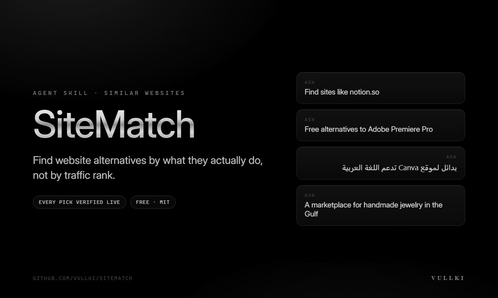
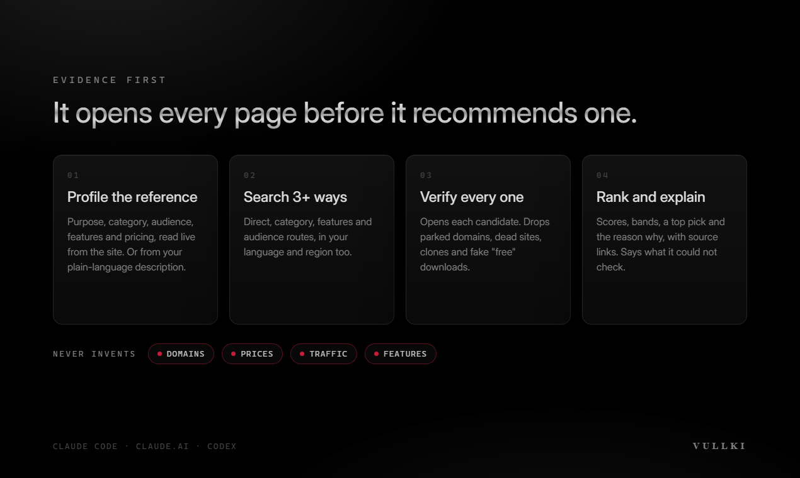
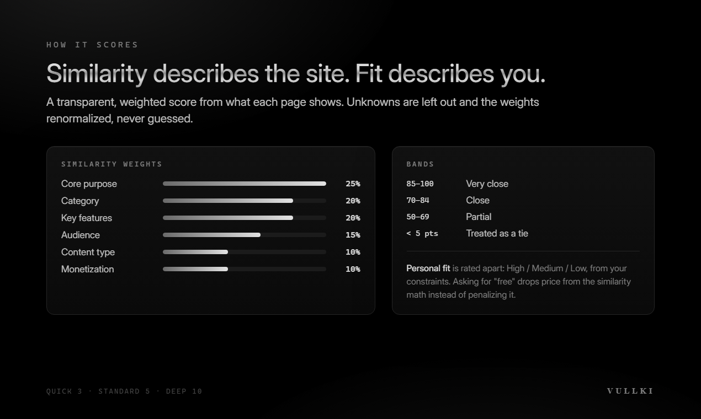

<p align="center"></p>

# SiteMatch

An evidence-led skill for finding and comparing website alternatives. It ranks sites by what they do and who they serve, then separately rates how well each one fits the person asking — not by traffic overlap.

SiteMatch does **not** provide traffic graphs, visit estimates, or backlink data. Those are strengths of dedicated analytics tools. This skill is for verified functional matching: open the pages, compare purpose, features, audience, and constraints, and say what could not be checked.

## Requirements

The host agent needs live web search and the ability to open pages. Without those, the skill should only report that verification cannot be completed — it should not present remembered sites as verified recommendations.



## Install

Copy the whole `sitematch` folder, not just `SKILL.md`. The folder name must stay `sitematch`.

### Claude Code

Personal install (all projects on this machine):

```bash
mkdir -p ~/.claude/skills
cp -R sitematch ~/.claude/skills/sitematch
```

On Windows, `~/.claude` is `%USERPROFILE%\.claude`. Project-only install: copy the folder to `.claude/skills/sitematch` inside the repository.

See [Use Skills in Claude Code](https://code.claude.com/docs/en/skills).

### claude.ai

1. Enable **Code execution and file creation** in Settings → Capabilities (called **Create and edit files** in some layouts).
2. Go to **Customize → Skills**.
3. Click **+**, then **Create skill**, then **Upload a skill**.
4. Upload a ZIP whose root is the `sitematch` folder (so the archive contains `sitematch/SKILL.md`, not loose files).

```
sitematch.zip
 └── sitematch/
     ├── SKILL.md
     ├── README.md
     ├── LICENSE
     ├── CHANGELOG.md
     ├── evals/
     ├── agents/
     ├── assets/
     └── docs/
```

Toggle the skill on after upload. See [Use skills in Claude](https://support.claude.com/en/articles/12512180-using-skills-in-claude).

### Codex / ChatGPT

This package includes `agents/openai.yaml` for Codex, ChatGPT, API, and Atlas. Follow the host's skill-install path and keep that file in place.

## Example

Ask in plain language, or pass a URL:

- `Find sites like https://www.notion.so`
- `Free alternatives to Adobe Premiere Pro`
- `بدائل لموقع Canva تدعم اللغة العربية`
- `A marketplace for handmade jewelry focused on the Gulf region`

The skill profiles the reference live, then returns a short profile, a ranked table (similarity, price, and — when it knows your preferences — fit for you), and a recommended first pick. Quick mode keeps that short; Standard and Deep add per-site breakdowns.

It will not invent domains, prices, or traffic numbers. If a page cannot be opened, that candidate is left out of the verified ranking or marked as an unverified lead.

## How it ranks



Each verified site gets a Similarity score out of 100, a weighted mean of six dimensions: core purpose 25%, category 20%, key features 20%, audience 15%, content type 10%, monetization 10%. Dimensions it cannot check on either side are left out and the remaining weights renormalized, never guessed. Scores come with a band (85–100 Very close, 70–84 Close, 50–69 Partial), and gaps under 5 points count as ties.

Personal fit (High / Medium / Low) is rated separately from your constraints and preferences, so it never bends the Similarity score. Asking for something free or cheaper takes monetization out of the similarity weights instead of penalizing sites for their price.

## Depth

- **Quick** — 3 matches, compact table and top pick
- **Standard** (default) — 5 matches, full table and per-site breakdowns
- **Deep** — up to 10 matches, extra pricing and documentation checks

Say "quick" or "thorough" to pick a depth, or let the skill infer it from the request.

## Package

```
sitematch/
├── SKILL.md
├── README.md
├── LICENSE
├── CHANGELOG.md
├── evals/prompts.md
├── agents/openai.yaml
├── assets/icon.svg
└── docs/images/        # README images
```

## License

[MIT](LICENSE)
